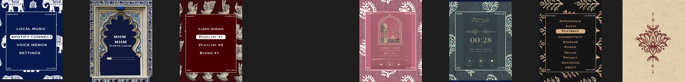
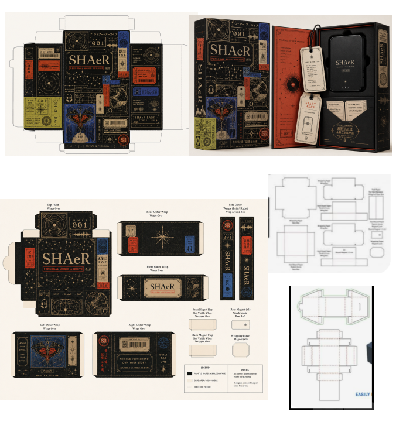

# SHAeR design archive

Interface explorations, theme studies and packaging design, stored alongside the SHAeR codebase.

**Project status:** in development. These designs and software files do not establish a working physical device. Hardware validation remains pending.

## Browse the work

- [Interface and theme gallery](ui/README.md) — all 20 visual groups, frames and image studies from the interface file. Original ARCHIVE labels are retained.
- [Packaging and dielines](packaging/README.md) — packaging board and editable local Figma copy.
- [Export manifest](export-manifest.json) — frame IDs, original links, dimensions and checksums.

## Interface exploration

## Packaging concept

## Editable sources

- [SHAeR interface file](https://www.figma.com/design/9sn5HaLeuYGIiYAYTc3oPW/shaer-ui)
- [SHAeR packaging file](https://www.figma.com/design/6JsvnIfVkZjl6Tehq2Ip84/HEHEHE)
- [Packaging .fig backup](packaging/source/shaer-packaging.fig) — download and import into Figma; GitHub does not render .fig files.

The PNG files are static snapshots. Use the original Figma files for layers, components and interactions. Imported references and exploratory visuals are retained as design history; they are not evidence of manufactured hardware.
