# SHAeR interface and theme studies
A complete gallery of the visual groups, frames and image studies in the interface source file. Exploratory and archived versions are preserved as labelled in Figma.

Exports captured on 30 October 2026. Figma links open the editable source with its existing access settings.

## ARCHIVE · indian raga
[Open source frame in Figma](https://www.figma.com/design/9sn5HaLeuYGIiYAYTc3oPW?node-id=1-2)

## ARCHIVE · ghilbi
[Open source frame in Figma](https://www.figma.com/design/9sn5HaLeuYGIiYAYTc3oPW?node-id=1-82)

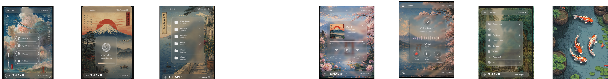

## ARCHIVE · windows xp
[Open source frame in Figma](https://www.figma.com/design/9sn5HaLeuYGIiYAYTc3oPW?node-id=1-108)

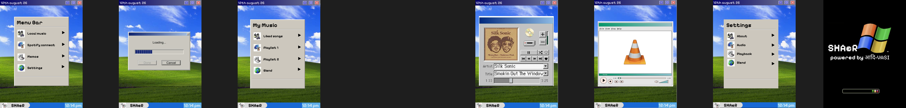

## ARCHIVE · japanese punk
[Open source frame in Figma](https://www.figma.com/design/9sn5HaLeuYGIiYAYTc3oPW?node-id=1-411)

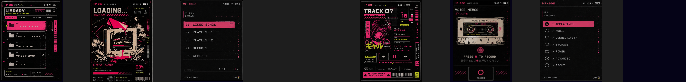

## ARCHIVE · bombay ticket
[Open source frame in Figma](https://www.figma.com/design/9sn5HaLeuYGIiYAYTc3oPW?node-id=1-428)

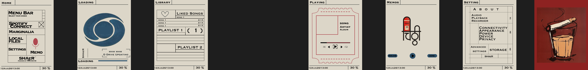

## ARCHIVE · dark archive
[Open source frame in Figma](https://www.figma.com/design/9sn5HaLeuYGIiYAYTc3oPW?node-id=1-666)

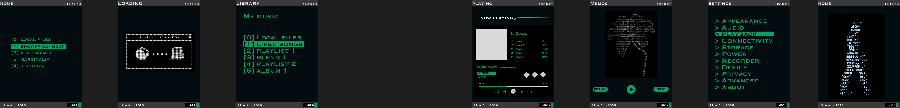

## ARCHIVE · common
[Open source frame in Figma](https://www.figma.com/design/9sn5HaLeuYGIiYAYTc3oPW?node-id=1-816)

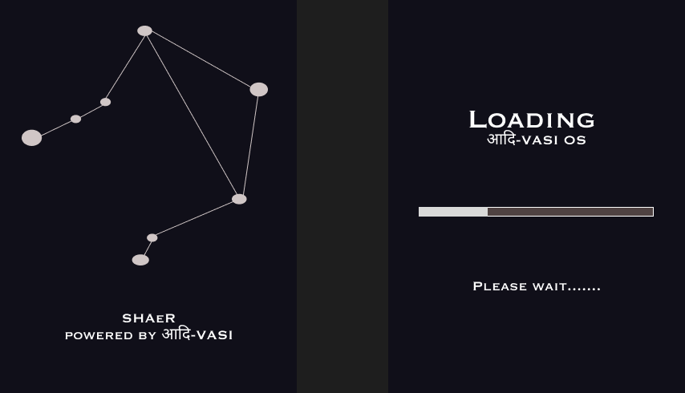

## ARCHIVE · image 58
[Open source frame in Figma](https://www.figma.com/design/9sn5HaLeuYGIiYAYTc3oPW?node-id=1-841)

## ARCHIVE · image 63
[Open source frame in Figma](https://www.figma.com/design/9sn5HaLeuYGIiYAYTc3oPW?node-id=1-842)

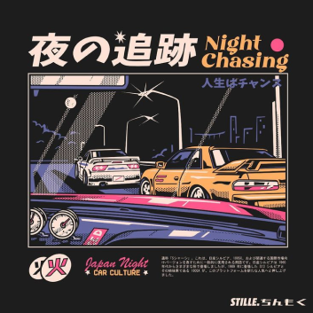

## Group 17
[Open source frame in Figma](https://www.figma.com/design/9sn5HaLeuYGIiYAYTc3oPW?node-id=53-2)

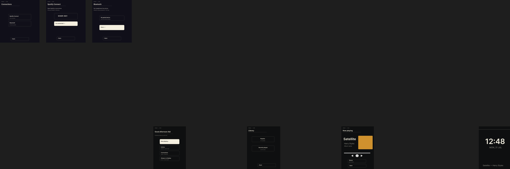

## ARCHIVE · 02 Library • 240×320 universal
[Open source frame in Figma](https://www.figma.com/design/9sn5HaLeuYGIiYAYTc3oPW?node-id=81-40)

## ARCHIVE · 02 Library • 240×320 universal
[Open source frame in Figma](https://www.figma.com/design/9sn5HaLeuYGIiYAYTc3oPW?node-id=81-16)

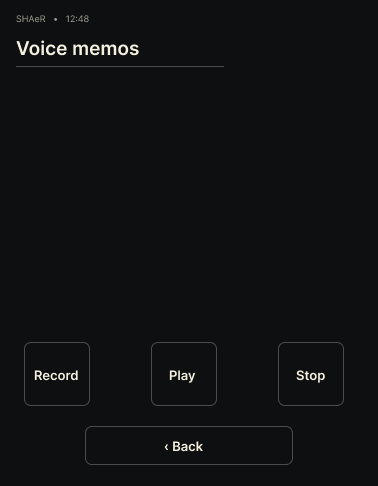

## ARCHIVE · 02 Library • 240×320 universal
[Open source frame in Figma](https://www.figma.com/design/9sn5HaLeuYGIiYAYTc3oPW?node-id=81-28)

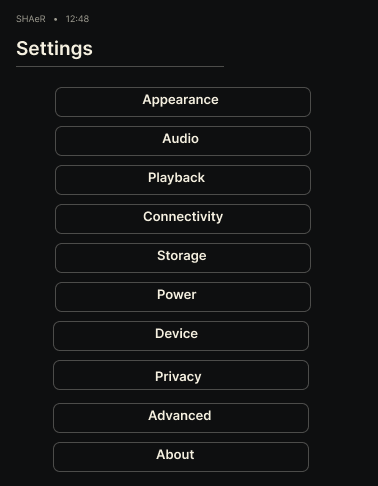

## image 66
[Open source frame in Figma](https://www.figma.com/design/9sn5HaLeuYGIiYAYTc3oPW?node-id=59-9)

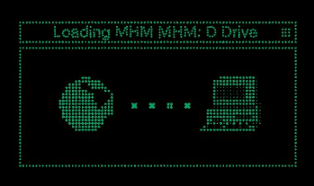

## image 67
[Open source frame in Figma](https://www.figma.com/design/9sn5HaLeuYGIiYAYTc3oPW?node-id=59-12)

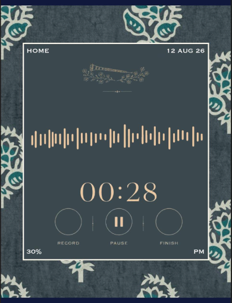

## image 68
[Open source frame in Figma](https://www.figma.com/design/9sn5HaLeuYGIiYAYTc3oPW?node-id=59-15)

## image 69
[Open source frame in Figma](https://www.figma.com/design/9sn5HaLeuYGIiYAYTc3oPW?node-id=59-18)

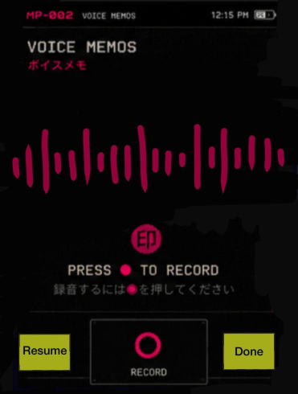

## image 70
[Open source frame in Figma](https://www.figma.com/design/9sn5HaLeuYGIiYAYTc3oPW?node-id=59-21)

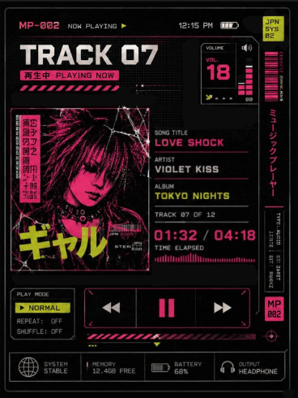

## image 71
[Open source frame in Figma](https://www.figma.com/design/9sn5HaLeuYGIiYAYTc3oPW?node-id=59-24)

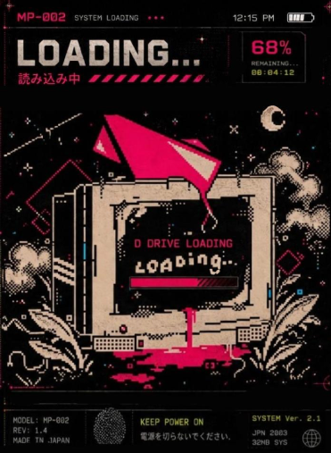

## Screenshot 2026-07-29 at 10.19.09 AM 1
[Open source frame in Figma](https://www.figma.com/design/9sn5HaLeuYGIiYAYTc3oPW?node-id=81-111)

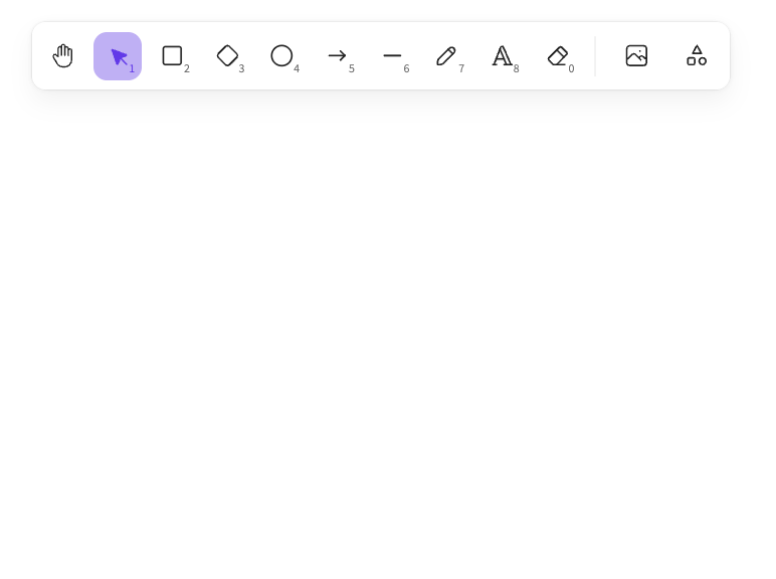
